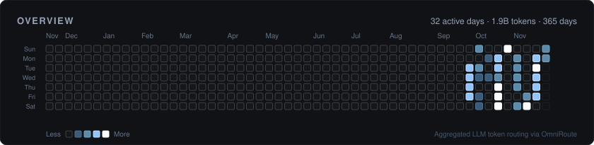

## About me

I'm studying for a Master of Information Technology at Universitas Indonesia while completing the Officer Development Program at BSN. I enjoy turning complicated processes into web applications and practical automation tools.

My recent work covers full-stack development, cloud workflows, applied machine learning, and tools for academic research. I'm open to selected freelance projects and collaborations.

## What I work on

Most of my software work uses React and Node.js, with APIs, databases, authentication, content management, file uploads, tests, and deployment included. For automation projects, I work with Google Cloud and Google Workspace APIs.

I also use Python and Jupyter for machine learning and NLP coursework. My academic workflow combines Zotero, Obsidian, and OpenCode to keep sources, analysis, revisions, and supporting evidence traceable.

## AI routing activity

## Selected work

### Educational e-portfolio platform

This is a multi-tenant e-portfolio and content management web platform with two live deployments. The goal was to give educators and professionals an accessible way to document, structure, and publish their career milestones and learning materials online.

I built the full stack using React, Vite, Express, Prisma, and MySQL. My work covered JWT authentication, dynamic content management, media uploads with Multer, data validation, and automated tests. Both deployments are accessible online, while the codebase remains private: [IFA Portfolio](https://project-ifa.vercel.app) and [ENCI Portfolio](https://porto-enci-tawny.vercel.app).

### WhatsApp personal finance automation

This is a serverless automation service that turns informal WhatsApp messages into structured expense records. The goal was to eliminate manual bookkeeping by extracting data directly from daily chat notes, receipt photos, and PDF invoices.

I built the pipeline in TypeScript on Google Cloud Run, integrating Firestore, Cloud Tasks, Google Sheets, Google Drive, and Gemini. I implemented HMAC webhook verification, duplicate-safe processing, review queues for edge cases, and automated tests. The codebase is private.

### Financial product UX prototype

This is a mobile-first web prototype that simulates an end-to-end digital gold-savings account journey. The goal was to test how a multi-step financial onboarding flow could feel intuitive and friction-free before committing to backend development.

I designed and implemented the interface with semantic HTML, modern CSS, and vanilla JavaScript. I focused on keyboard accessibility, immediate input validation, responsive screens, and clear state transitions between steps. This is a private concept simulation and not an official banking product.

### Music mood classification

This is a machine learning study focused on binary music mood classification. The goal was to predict whether a song carries a positive or negative mood from its audio attributes while avoiding subtle data leakage between splits.

Using Python, Jupyter, pandas, and scikit-learn, I followed the CRISP-DM methodology. I engineered audio features, kept label derivation strictly separate from model inputs, trained baseline and tuned classifiers, and evaluated the models with cross-validation and ROC metrics.

## Academic projects

### Business intelligence strategy for ITKPDN

This is a research project proposing an enterprise Business Intelligence strategy for the ITKPDN data environment at Indonesia's Ministry of Home Affairs. The goal was to evaluate organizational preparedness and design a practical roadmap for adopting automated analytics across regional data.

As a co-author in a graduate course research project, I assessed institutional readiness across data governance, infrastructure capabilities, and human resources. I then helped translate those findings into prioritized recommendations for phased BI deployment.

### HR information system for public procurement

This is a systems analysis and design project for an HR management information system tailored to public procurement personnel. The goal was to model how an organization can systematically track certifications, competencies, and talent assignments, using Indonesia's LKPP as a case study.

Working in a team, I contributed to the initial system request, feasibility analysis, user requirements specification, process modeling, and system architecture. This was an academic case study, not an official LKPP system.

## Tech I use

Other tools I use include Vite, REST APIs, Firestore, Google Workspace APIs, Jupyter, Zotero, Obsidian, OpenCode, and Remotion.

## Languages

- Indonesian: active
- English: active
- Arabic: passive

## Contact

I'm available for selected freelance work in web development, automation, applied data, and research tooling.

- [LinkedIn](https://www.linkedin.com/in/adib-raushanfikr-raharjo-b566101b6/)
- [adib.raharjo12@gmail.com](mailto:adib.raharjo12@gmail.com)

Personal projects and views shown here do not represent my employer or university.

